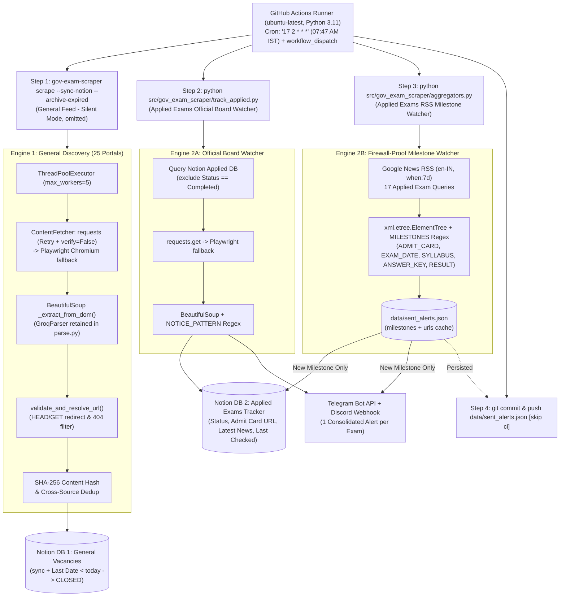

# End-to-End Pipeline Architecture & Production Review: `gov-exam-scraper`

**Repository:** `abhijithkm05/gov-exam-scraper` (local workspace: `D:\Github\Govt_Exam_Scrapper`)  
**Operating Budget:** $0/month (GitHub Actions, Groq Cloud free tier, Notion API, Telegram Bot API, Discord Webhooks, Google News RSS)

---

## 1. Problem Statement & Target Sources

### Why Manual Tracking Fails
Indian public-sector recruitment notifications are fragmented across dozens of central, state, banking, railway, and PSU portals that lack standardized RSS feeds or public APIs. Manual tracking fails across four dimensions:
1. **Portal Fragmentation & Unstable Infrastructure:** Official state and NIC portals (e.g., `.nic.in` domains) suffer from high latency, timeouts (`kpsc.kar.nic.in`, `karnatakajudiciary.kar.nic.in`), unverified/misconfigured TLS certificates, and heavy traffic crashes during circular releases.
2. **Non-Uniform & Dynamic DOMs:** Notices are published across unstructured HTML tables, anchor lists, PDFs, and client-side JavaScript SPAs (`ssc.gov.in`, `sbi.co.in`, `aai.aero`) where brittle CSS-selector scrapers break on layout changes.
3. **WAF / Cloud-IP Blocking:** Major portals (notably `sbi.co.in/careers` behind Akamai WAF) block or serve empty splash pages to cloud runner IPs (GitHub Actions Ubuntu runners), causing silent misses on critical events like admit card releases.
4. **Notification Fatigue vs. Missed Deadlines:** Broad job aggregators (FreeJobAlert, Testbook, Adda247, Oliveboard) mix high-volume unrelated posts with critical lifecycle milestones (exam dates, city intimation slips, admit cards, merit lists, answer keys), making it hard to track already-applied exams without missing deadlines or drowning in spam.

### Target Sources (Two-Tier Scope)

#### Tier A: Broad Discovery (`DEFAULT_SOURCES` in `src/gov_exam_scraper/scraper.py` — 25 Portals)
* **Karnataka State (8):** KEA (`cetonline.karnataka.gov.in/kea/`), KPSC (`kpsc.kar.nic.in/`), Karnataka State Police (`ksp-recruitment.in/`), Karnataka Forest Dept (`aranya.gov.in/`), Karnataka High Court (`karnatakajudiciary.kar.nic.in/recruitment.php`), KPTCL (`kptcl.karnataka.gov.in/`), BMRCL (`english.bmrc.co.in/Career`), Karnataka School Education / DSEL (`schooleducation.karnataka.gov.in/`).
* **Banking, Insurance & Regulatory (6):** IBPS (`ibps.in/`), SBI Careers (`sbi.co.in/web/careers/current-openings`, Playwright), RBI (`opportunities.rbi.org.in/scripts/vacancies.aspx`), NABARD (`nabard.org/careers-notices.aspx`), NICL (`nationalinsurance.nic.co.in/en/recruitment`), LIC (`licindia.in/careers`).
* **Central Commissions & Railways (5):** UPSC (`upsc.gov.in/examinations/active-examinations`), SSC (`ssc.gov.in/`, Playwright), RRB Bangalore (`rrbbnc.gov.in/`), NTA (`nta.ac.in/`), EPFO (`epfindia.gov.in/site_en/Miscellaneous_Recruitment.php`).
* **Engineering, Defence & PSUs (5):** ISRO (`isro.gov.in/Careers.html`), HAL (`hal-india.co.in/Career_Listing.aspx`), BEL (`bel-india.in/careers/`), DRDO RAC (`rac.gov.in/`), AAI (`aai.aero/en/careers/recruitment`, Playwright).
* **Consolidated State Feed (1):** Karnataka FreeJobAlert (`freejobalert.com/karnataka-government-jobs/`). *(India Post portals were also appended to `portals.yaml` and `track_applied.py` targets).*

#### Tier B: Personal Lifecycle Tracking (17 Applied Exams via Notion + Google News RSS)
Actively tracks submitted applications across official boards (`track_applied.py`) and Google News `en-IN` RSS (`aggregators.py`):
1. RRB Section Controller (`CEN 03/2026`)
2. RRB Junior Engineer (`CEN 04/2026`)
3. UPSC EPFO – APFC (`Special Advt 52/2026`)
4. India Post GDS (`Schedule II, July-2026`, merit-list based)
5. HAL Design / Management Trainee (`HAL/CHRC-TM/RECT-02/2026`)
6. KPSC Gazetted Probationers (`KAS 2026-27`)
7. KEA VAO & Land Surveyor (`VAO-RK & LAND SURVEYOR-RK`)
8. KFD Forest Watcher Group 'D'
9. SBI Junior Associates / Clerk (`CRPD/CR/2026-27/17`)
10. IBPS Customer Service Associates (`CRP CSA-XVI`)
11. NICL 500 Assistants
12. IBPS RRB XV – Office Assistant (`CRP RRBs XV`, Reg `2751203520`)
13. RRB NTPC Graduate (`CEN 06/2026`, Reg `C62628792324`)
14. RRB NTPC Under Graduate (`CEN 07/2026`, Reg `C72628792324`)
15. RRB Station Master (`CEN 08/2026`, Reg `C82628792324`)
16. RRB Isolated Categories (`CEN 09/2026`, Reg `C92628792324`)
17. KEA Group C FDA / SDA (`ED/KEA/14 & 16/RECRUITMENT/2026(RPC)`, App ID `267000001277482`)

---

## 2. End-to-End Data Pipeline

The production pipeline runs as two decoupled workflows inside a single daily GitHub Actions job (`.github/workflows/daily-run.yml`): **Engine 1** (broad vacancy discovery) and **Engine 2** (applied-exam notice & milestone surveillance).

### Stage 1: Discovery
* **Engine 1 (`scraper.py`):** Iterates over active `ScraperSource` entries in `DEFAULT_SOURCES` concurrently using `ThreadPoolExecutor(max_workers=5)`.
* **Engine 2a (`track_applied.py`):** Queries the Notion Applied Exams database (`NOTION_APPLIED_DB_ID`) at runtime, excludes rows where `Status == "Completed"`, and uses each row's `Notice Board URL`, `Exam Name`, and `Notification No` as discovery targets—so new applied exams require zero code edits in `track_applied.py`.
* **Engine 2b (`aggregators.py`):** Queries Google News RSS (`https://news.google.com/rss/search?q=<query>+when:7d&hl=en-IN&gl=IN&ceid=IN:en`) across `EXAM_MONITORS` to bypass portal WAF blocks (e.g., SBI Akamai) and coaching-site URL path churn (Testbook, Adda247, Oliveboard).

### Stage 2: Fetching
* **Primary HTTP Layer (`fetch.py` / `track_applied.py`):** Uses `requests.Session` with desktop Chrome `User-Agent`, `Accept-Language: en-US,en;q=0.9,kn;q=0.8`, `urllib3` `Retry` (`total=3`, `backoff_factor=1.0` on `429, 500, 502, 503, 504`), 60s timeouts, and `verify=False` (with `InsecureRequestWarning` suppressed) to tolerate misconfigured government SSL chains.
* **Headless Browser Fallback:** Invokes Playwright Chromium (`headless=True`, `ignore_https_errors=True`, `wait_until="domcontentloaded"`, 2s settle wait) when `use_playwright=True` (SSC, SBI, AAI) or when `requests` fails / returns sparse HTML (`<= 1000` chars in `track_applied.py`).
* **Pre-Flight Link Verification (`ContentFetcher.validate_and_resolve_url`):** Runs `HEAD` (falling back to streaming `GET` on `403`/`405`) with `allow_redirects=True` (8s timeout) to resolve 301/302 redirects to final URLs and drop dead `>= 400` / `404` links before persistence or alerting.
* **RSS Fetching (`aggregators.py`):** Standard HTTP `GET` (12s timeout) against `news.google.com/rss/search`.

> **Interview Trade-off (Why `verify=False` + Dual Fetching):** Government `.nic.in` sites frequently serve expired or incomplete intermediate SSL certs; `verify=False` trades strict MITM cert validation on read-only public pages for scraper availability. Meanwhile, defaulting to `requests` and reserving Playwright for SPAs keeps CI runtime and memory low (~14 min total vs. launching Chromium for all 25+ sites).

### Stage 3: Parsing (HTML / XML / LLM — No PDF Binary Parsing or OCR)
* **What IS Implemented:**
  * **Deterministic DOM Parsing (`scraper.py` → `_extract_from_dom`):** Strips `script, style, nav, header, footer, svg, noscript, aside` via BeautifulSoup (`html.parser`). Scans `<table>` rows for vacancy keywords (`apply`, `recruitment`, `officer`, `clerk`, `post`, `exam`, `engineer`, `2026`, `pdf`), extracts `apply_link` and `.pdf` circular `pdf_link` via `urljoin`, and falls back to scanning prominent `<a>` tags if no tables match.
  * **Targeted Circular Regex (`track_applied.py`):** Strips `script, style, nav, footer` and matches `<a>` text against `NOTICE_PATTERN` (`time table`, `exam date`, `schedule`, `admit card`, `hall ticket`, `cbt`, `written exam`, `merit list`, `shortlist`, `document verification`, `selection list`, `city intimation`) paired with exam-specific tokens.
  * **RSS XML Parsing (`aggregators.py`):** Parses `<item>` (`title`, `link`, `source`) using Python's built-in `xml.etree.ElementTree`, then classifies titles against `MILESTONES` regexes (`ADMIT_CARD`, `EXAM_DATE`, `SYLLABUS_PATTERN`, `ANSWER_KEY`, `RESULT`).
  * **LLM Extraction (`parse.py` → `GroqParser`):** Retained in the package using Groq `json_object` mode (`temperature=0.1`, 429 linear backoff). However, **it is no longer on the critical path of `GovExamScraper.scrape_source`** because testing on `2026-09-02` hit Groq free-tier `413`/`429` TPM limits (8,000 TPM on `qwen/qwen3.6-27b`, 24k–59k token pages) and `{"exams": []}` misses when regex line-filtering broke HTML table row alignment.
* **What is NOT Implemented (Important Fact Check):**
  * **No PDF content parsing or OCR:** Neither `PyMuPDF` (`fitz`), `pypdf`, nor Tesseract OCR is installed or used. `.pdf` URLs are extracted from `<a href>` attributes, verified via HTTP status checks, and stored/forwarded as direct download links.

### Stage 4: Cleaning & Normalization
* **Pydantic v2 Domain Schemas (`models.py`):** `ExamRecord` enforces types and constraints (`exam_name` 2–300 chars, `eligibility` max 500 chars).
* **Enum Normalization:** `Sector` (11 categories) and `ExamStatus` (`OPEN`, `CLOSED`, `UPCOMING`, `UNKNOWN`) normalize raw strings via `_missing_`.
* **Date Normalization (`parse_flexible_date` / `parse_date_safely`):** Strips ordinal suffixes (`1st`, `2nd`, `3rd`, `4th`), normalizes `/` and `.` separators, and parses 9+ Indian date formats (`DD-MM-YYYY`, `YYYY-MM-DD`, `DD Month YYYY`, etc.) into ISO `datetime.date`.
* **HTML Token Condensation (`fetch.py` → `clean_html`):** For LLM paths, converts `<a>` tags to Markdown `[text](abs_url)`, keeps `RELEVANT_KEYWORDS` lines +/- 1 context line, and caps output at 6,000 characters (~1,500 tokens).

### Stage 5: Deduplication
Three distinct deduplication mechanisms operate across the pipeline:
1. **In-Memory Cross-Source Deduplication (`scraper.py`):** `scrape_all()` normalizes `exam_name` (`re.sub(r"[^a-zA-Z0-9]", "", rec.exam_name.lower())[:40]`) in `seen_keys` to drop duplicates across portals/aggregators within a single run.
2. **Deterministic SHA-256 Fingerprinting (`models.py` & `scraper.py`):** `ExamRecord.recalculate_hash()` computes a 64-char SHA-256 hex digest over:
   `exam_name.lower() | sector | last_date | apply_link | pdf_link | status`.  
   `sync_to_notion()` queries existing `Content Hash` values from Notion and skips unchanged records.
3. **Git-Persisted Milestone & URL Cache (`aggregators.py` → `data/sent_alerts.json`):** Stores both `urls` and `milestones` (`"{exam_name}:{MILESTONE_KEY}"`, e.g., `SBI Junior Associates:ADMIT_CARD`). Even if 20 newspapers publish the same admit card over several days, only the first verified match alerts; subsequent matches for that milestone are suppressed.

### Stage 6: Storage & Lifecycle Management
No relational/NoSQL database (Postgres, SQLite, MongoDB) is used. State lives in:
* **Notion Database 1 (`NOTION_DATABASE_ID`):** General Vacancies Feed (`Name`, `Sector`, `Status`, `Apply Link`, `Last Date`, `Eligibility`, `Content Hash`, and conditionally `Notification PDF` if present in schema).
  * **Auto-Archival (`archive_expired_exams()`):** Queries Notion for `Last Date < today` AND `Status != CLOSED`, then `PATCH`es `Status` to `CLOSED`.
* **Notion Database 2 (`NOTION_APPLIED_DB_ID` = `535459a2751646f4906c7c5e03f337ef`):** Applied Exams Tracker (`Exam Name`, `Authority`, `Notification No`, `Registration No`, `Status`, `Exam Date`, `Exam Timeline`, `Notice Board URL`, `Admit Card URL`, `Latest News`, `Last Checked`).
  * `track_applied.py` stamps `Last Checked` and `Latest News` (plus `Admit Card URL` / `Status = "Admit Card Out"` on hall ticket detection).
  * `aggregators.py` updates `Latest News`, `Status` (`Exam Scheduled`, `Admit Card Out`, `Result Out`), and `Admit Card URL`.
* **Git Repository State (`data/sent_alerts.json`):** Committed and pushed back to `main` at the end of every GitHub Actions run by `github-actions[bot]` with `[skip ci]` to persist state across stateless CI containers.

### Stage 7: Alerts & Output
* **General Vacancy Alerts Disabled:** Step 1 runs `gov-exam-scraper scrape --sync-notion --archive-expired` *without* `--notify`, silencing general vacancy pings.
* **Consolidated Applied-Exam Alerts:** `track_applied.py` and `aggregators.py` dispatch formatted Markdown messages/embeds to **Telegram** (`api.telegram.org/bot<TOKEN>/sendMessage`) and **Discord** (`DISCORD_WEBHOOK_URL`). `aggregators.py` groups all newly triggered milestones for an exam into **one message per exam per run**.
* **Local / On-Demand Exports:** `cli.py` supports `--output` to `.json` (`exams.json`) or `.csv`, plus Rich terminal tables.

---

## 3. Tech Stack, Infrastructure & Production Reality Check

### Exact Tech Stack
* **Language & Packaging:** Python `3.11` (CI) / `>=3.10` (`pyproject.toml`), `hatchling` build backend, `python-dotenv`.
* **CLI & Terminal UI:** `typer>=0.12.3`, `rich>=13.7.0`.
* **Data Validation & Config:** `pydantic>=2.7.0`, `pydantic-settings>=2.2.0`.
* **Fetching & Browser Automation:** `requests>=2.31.0`, `urllib3` (`Retry`), `playwright>=1.44.0` (headless Chromium).
* **Parsing:** `beautifulsoup4>=4.12.3`, `xml.etree.ElementTree` (stdlib), `re` (stdlib), `groq>=0.9.0` (`GroqParser` retained for LLM JSON extraction).
* **Caching & Retries:** `tenacity>=8.3.0`, `cachetools>=5.3.3` (declared in `pyproject.toml`; active `fetch.py` uses `urllib3` `Retry` and `aggregators.py` uses `data/sent_alerts.json`).
* **Storage & Alerting:** Notion REST API (`v2022-06-28` via `requests`, replacing earlier `notion-client` usage), Git-backed `data/sent_alerts.json`, Telegram Bot API, Discord Webhooks, Google News RSS (`en-IN`).
* **Compute & Scheduling:** GitHub Actions (`ubuntu-latest`), cron `'17 2 * * *'` (02:17 UTC / **07:47 AM IST** daily; `:17` offset avoids top-of-the-hour queue drops/delays) + `workflow_dispatch`, `permissions: contents: write`.
* **Testing / Linting (Dev):** `pytest`, `pytest-cov`, `pytest-mock`, `mypy` (strict), `ruff`. *(Note: `pytest` step was removed from `daily-run.yml` after exit code 5 when no tests were collected in the repo).*

### Architecture Diagram

### Production Maintenance Risks & Interview Talking Points
If maintaining this in production or defending it in a Staff/Senior Data Engineer interview, be ready to explain these concrete trade-offs and known edge cases from the codebase:
1. **Notion Query Pagination Cap (`scraper.py` & `track_applied.py`):** In the current `requests.post` implementations (`sync_to_notion`, `get_applied_exams`), queries request `page_size: 100` (or default) without looping on `has_more` / `next_cursor`. Once the General Vacancies DB exceeds 100 rows, existing `Content Hash` entries past page 1 won't be loaded, causing duplicate page creations until pagination is restored.
2. **Milestone Lock-Out Across Cycles (`aggregators.py`):** `sent_alerts.json` keys milestones as `"{exam_name}:{cat_key}"` permanently. If an exam postpones and issues a *revised* `EXAM_DATE` or Phase-II `ADMIT_CARD`, that milestone key is already locked and would be suppressed unless keys include a date/hash or are scoped per phase.
3. **`scraper.py` Revert Regression Risk (`2026-09-18`):** To fix a `SyntaxError` (`),,`) and `AttributeError` (`dict` entries in `DEFAULT_SOURCES`), `git checkout $firstCommit` was executed on `scraper.py` with a regex patch for `getattr(s, "is_active", False)`. Verify `src/gov_exam_scraper/scraper.py` on `main` to ensure `_extract_from_dom` and the 25-portal `DEFAULT_SOURCES` weren't rolled back to the initial 5-source Groq-only commit.
4. **GitHub Actions Cron Best-Effort Jitter:** GitHub Actions scheduled workflows are queued on shared infrastructure and can be delayed or dropped—even with the `:17` minute offset. For strict SLA execution, trigger `workflow_dispatch` via an external scheduler (e.g., `cron-job.org` `POST` to the GitHub API).